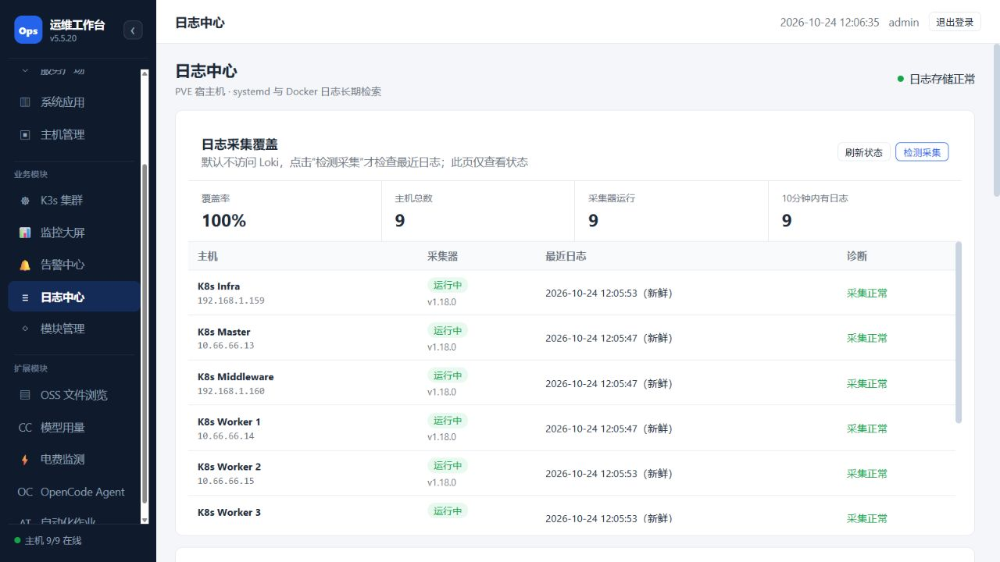

# OpsCenter 审查问题修复与生产验收

实施日期：2026-10-23 开始本地修复；2026-10-24 11:25–12:07 CST 完成生产发布和验收。用户任务：优化前次全模块审查发现的问题。前后端业务版本 5.5.20；工作区 HEAD `faa7596ad3d58b5ca67501cef23121abbee0cfc6`，发布包含未提交工作区源码，不能用 HEAD 单独复建。

本轮处理 14 项审查问题：修复数据安全及功能缺陷、完成旧 SSH 凭据迁移和日志覆盖接入、补齐 CI 脚本与实际发布归档。生产运行组合已冻结；全量镜像重建和线上 CI 切换尚未执行，发布完整性采取下文所述的阶段性措施。

## 逐项结果

| 原编号 | 问题 | 本轮处理与验证 |
|---|---|---|
| 1 | 远程保存先截断原文件 | 同目录独占临时文件，完整写入和大小检查后使用 SFTP 原子替换；保留原权限/属主，复核目标状态并清理失败临时文件。真实 PVE 临时文件验证中断不丢原内容、成功保存及权限保留；未编辑生产业务文件。 |
| 2 | UFW 编号删除可能误删 SSH 放行 | 删除前重新读取实际规则，比对端口、协议、来源、动作及方向；变化返回 409，SSH 保护根据真实规则判断；按已核验规则内容删除，避免编号移动。保留无协议规则的 any 兼容。使用模拟规则验证，未在线删除防火墙规则。 |
| 3 | 10 条旧 SSH 凭据未加密 | 先验证密钥恢复与备份，再用既有迁移脚本迁移 10 条；旧格式剩余 0，10 条均可解密。8 台远程在管主机 SSH 认证通过；PVE 路径由真实 SFTP 验证覆盖。归档 ASR 不恢复接入。 |
| 4 | 缺失指标被记成 0 | 共同采集入口仅写入真实、有限且范围有效的指标，缺失保持未知，保留采样时间并拒绝过期样本。覆盖真实零值、NaN、缺项及旧时间测试。 |
| 5 | 坏样本拒绝整批监控 | 按条校验、保存有效项，返回拒绝索引；全部无效时返回 400。兼容旧数组请求，并分块提交。有效主机不再被单台坏样本拖累。 |
| 6 | 退役资产仍参与监控 | 以资产模块的有效 ID 清单同步监控启用状态，停止采集退役对象并保留历史。生产从 9/10 修正为 9/9，旧 ASR 不再计入当前健康分母。 |
| 7 | Running/Ready=False 被漏报 | 检查 Ready 与容器就绪，保留 120 秒启动宽限，排除已完成和正在删除对象；新增未就绪 findings。故障样本测试通过。 |
| 8 | 历史 Warning 决定当前健康 | 当前资源状态决定健康；近 5 分钟事件按最后观测时间排序，已恢复对象的旧事件不再冒充当前故障。历史事件仍可查询。 |
| 9 | K3s 时间/策略字段错配 | 四个前端事件视图兼容 first_at/last_at，网络页消费 types；后端补 eventTime/series 时间回退。生产 14/14 策略类型、12/12 事件时间非空，浏览器可见 Ingress/Egress 和具体时间。 |
| 10 | 日志摘要掩盖缺口 | 受限内部接口读取有效资产与采集状态，一次 Loki 聚合查询确认近 10 分钟实际送达；未运行、无新日志或数据源不可用如实降级。Middleware/Worker3 新装 Alloy 1.18.0；Worker3 WG 入口超时但同主机登记 LAN 入口 200，部署逻辑补可信地址回退。无 Docker socket 时移除 Docker 来源，保留 journal。最终运行与新鲜度均 9/9。 |
| 11 | 数据库发现缺 server_id | 前端传当前主机 query.server_id，无主机不触发；构建与参数路径检查通过。未在线触发生产数据库发现写入。 |
| 12 | PostgreSQL 账号 DDL 参数绑定错误 | 使用 psycopg.sql.Literal 安全构造 PASSWORD 字面量，Identifier 保留。临时隔离 PostgreSQL 实测 CREATE/ALTER 成功并事务回滚，临时 Pod 删除，无测试账号残留。 |
| 13 | CI 遗漏两个模块 | 现有脚本加入 automation、opencode_agent 的 Python/Node 检查及 gateway、runner、automation 镜像构建/打包，补 release.json；Linux 实测 shell 密码入口。脚本语法通过；未触发整条 CI 或切换生产 Jenkins 配置。 |
| 14 | 源码覆盖/镜像版本无法对账 | 对核心、OSS、模型用量的 7 份共享源码统一；电费目录版本修正 0.10.0。受改源码使用不可变 ConfigMap，最终 33 项挂载源码 SHA256 与发布清单一致。冻结全部 14 Deployment 的实际源码/静态资源、29 个 ConfigMap、镜像 digest 与恢复脚本；补 CI 发布元信息。仍使用既有基础镜像，未完成纯镜像发布替换。 |

## 验证证据

- 自动检查合计 **805 项通过**：backend/Agent 455；alerts 43、service-catalog 38、host-inventory 20、host-monitor 16、K3s 6、logs 10、电费 107、SMS 6、runtime 8、extension worker 1、automation 25、OpenCode 44；前端 Node 21、OpenCode 界面异步检查 5。完整后端最终重跑 455/455，其余分组及最终定向复核见 `checks-final.json`。电费使用工作区既有 Apprise 环境。
- Windows 原有 1 项 POSIX shell 用例仍按平台跳过；相同入口的空/非空密码行为已在临时 Linux Pod 实测。另完成真实 PostgreSQL DDL 和真实 SFTP 成功/中断验证。
- Vite 构建、CI bash 语法和 git diff --check 通过；仍有既有 ECharts 大分包和 Python 废弃 API 警告。
- 2026-10-24 12:02 CST 业务 API 复核：29 个受测读取路径 200，受测需登录路径匿名 401；健康检查匿名 200。两个对外节点入口 `/v3/`、`/api/v2/health`、`/v3/release.json` 均 200。
- 生产 14 Deployment 就绪，db/loki StatefulSet 就绪，6/6 节点 Ready；监控 9/9、日志 9/9 且全部近 10 分钟有日志。K3s 快照 145 Pod、142 Running、0 Failed、0 超宽限未就绪，26 PVC 全部绑定；这些是验收时快照，滚动期间数量会短暂变化。
- 浏览器覆盖值班首页、K3s 概览与网络、日志查询/检测采集、五个扩展入口。会话保留，5.5.20 可见，首页摘要恢复正常；OSS 可用、模型用量采集正常、电费数据正常、OpenCode 执行环境连接、自动化原有模板可见。本轮没有运行新的模型任务或生产自动化作业。
- 后端全量复测首次发现旧 Alloy 单测依赖镜像内模板路径；将测试显式绑定仓库模板并隔离网络探测后，最终 455 项通过。未通过修改业务判断掩盖该失败。

证据文件：`checks-final.json`、`production-postflight.json`、`production-final.json`、`external-entry-final.json`、`migration-and-real-sftp.json`、`ssh-and-alloy-final.json`、`integration-pg.json`、`browser-snapshots.json`、`browser-logs-final.png`、`release-manifest-final.json`。目录沿用最初修复日期 `audit-fixes-20261023`，生产数据日期以文件内时间为准。

## 影响、备份与回滚

影响 8 个 Deployment：backend、web、资产、监控、K3s、日志、OSS、模型用量。新增/更新两台主机的 Alloy，不重启宿主机/VM。数据库仅迁移 SSH 密文、增加监控启用字段并调和资产生命周期；未删除历史监控和业务数据。保留既有工作区修改，未提交、tag 或推送。

生产备份根目录（root 专用 0700）：`/home/ubuntu/opscenter-audit-fixes-20261024-112515`。包含变更前 8 Deployment、14 个引用 ConfigMap、5 个相关 Secret 的受保护备份、旧 web 静态包；数据库备份覆盖本次可变表 `opscenter.servers`、`host_monitor.monitored_hosts` 及完整资产模块库，均经 pg_restore --list 和 SHA256 检验。密钥恢复验证通过。**这是变更范围备份，不是全库灾备。** 不将凭据内容、密钥或 Secret 值下载到项目文档。

回到变更前部署：在 master 上以 root 执行备份目录的 `rollback.sh`；其 `rollback.py` 按当前 resourceVersion 完整替换原 Deployment 模板并逐个等待就绪，能移除本次新增的调度字段。旧代码已具备 SSH 密文兼容能力，回滚部署时应保留迁移后的密文与解密密钥，不恢复旧明文数据。数据库恢复应单独评估，不能直接覆盖后续新增数据。

最终运行组合位于备份根目录 `release-final/`：14 份实际源码/静态资源 tar、Deployment 清单、29 个 ConfigMap、镜像 ID、SHA256SUMS 和 restore.py/restore.sh；19 个归档文件逐项校验通过。恢复最终组合前必须保有相同基础镜像及持久卷/Secret；归档未导出基础镜像、数据库全集或 PVC 数据。前端 release.json 为 r2，backend/logs 后续修订为 r3，统一对应关系见最终发布清单，二者业务版本均 5.5.20。

两台 Alloy 原配置/启用状态与恢复脚本在各自 `/var/backups/opscenter-audit-alloy-20261024/`，仅回滚 Alloy；原始基线不会被第二次部署覆盖。

## 部署过程与剩余边界

- 前晚中断的全库导出留下约 3.9 GB 未完成文件和等待客户端的数据库 COPY 会话；发布时该会话阻塞新增字段 DDL，继而使请求排队。按 pg_dump 应用名、ClientWrite 等待与启动时间核对后，仅终止该废弃导出连接及客户端进程，业务恢复；改用上述范围明确且校验通过的备份。未把残缺导出当有效备份。
- 资产模块滚动后曾落到 worker2，挤占 backend 滚动内存余量；将资产固定回原先 worker1，恢复 backend 滚动空间。web 原有硬反亲和要求 maxSurge=0/maxUnavailable=1，发布脚本误用 1/0 导致新副本 Pending；已恢复原策略并修正脚本。最终 web 2/2，backend 1/1，其余 Deployment 就绪。worker2 内存仍偏紧，后续容量调整需另行实测规划。
- 浏览器历史事件页可见当天 metric-history-retention 的 DeadlineExceeded；本次不重跑会删除历史记录的保留作业，也不把这条历史记录隐藏。当前监控读取、采集与查询已验证正常；下次保留作业执行结果尚未验。
- CI 脚本已补齐，但线上 CI 配置切换、全量镜像重建/导出与从零恢复演练未做，不能宣称已完成纯镜像可复建发布。
- 告警外部投递保持暂停，SMS/PVE 凭据未配置；Chrome 沙箱 iframe 空白、自动化停止不保证子命令退出等既有边界未在本轮解决。新功能路线仍按原审查报告：优先备份恢复验证、证书/告警闭环，再做容量趋势与作业审批。

Git 归档补充：本次双仓提交包括已验收的工作台及模块源码、部署文件、测试和静态产物；未完成安卓工程及其专用依赖保留在原工作区。发布证据摘要见 evidence/2026-10-24/。操作备份和原始凭据不入库。
